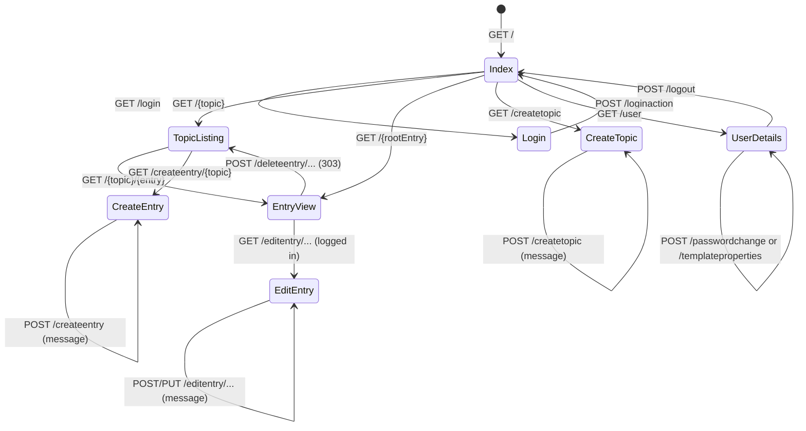

# Template development guide

uBlog renders every HTML page with **one Mustache entry template, `index.template`**, plus partials it includes. Request handlers do not choose a template per page. They fill a context with flags and data, and `index.template` decides what to show.

## How a request becomes HTML

1. `RequestHandlerService` asks each `AbstractRequestHandler` in order whether `matches(path)`. The first match wins. `ContentHandler` matches everything and is last.
2. `AbstractRequestHandler.handleRequest` creates a fresh `MustacheBlogContext`. It looks up the session from the `session` cookie and sets `LOGGED_IN`, plus `USERNAME` if logged in.
3. The concrete handler calls setters on the context (see the table below).
4. `createHttpResponseFromContext` renders `index.template` with the context map via `MustacheTemplateService`. The key/value pairs of `theme.properties` are merged into the same map and **override** context keys of the same name.
5. Client errors (`createClientError`) render `index.template` with a fresh context. That context shows the `Error.md` content, `HAS_ERROR_MESSAGE=true`, and the user is **not** logged in. Templates must therefore render error messages on every page, not only on forms.

Template folder: `MUSTACHE_TEMPLATES_FOLDER` (`template/personal` or `template/plain` in this repo; `./run.sh` points at the former). Partials are included with `{{>name.template}}`. Mustache escapes `{{x}}`. Use `{{{DATA}}}` for pre-rendered HTML.

## Files a template folder must provide

| File | Included by | Purpose |
| --- | --- | --- |
| `index.template` | server (entry point) | Page skeleton and the switch over page flags |
| `html_start.template`, `html_end.template` | `index.template` | Document head/body open and close |
| `navbar.template` | `index.template` | Navigation, login/logout, user link |
| `login.template` | `{{#LOGIN}}` | Login form |
| `user.template` | `{{#USER_DETAILS}}` | Profile, password change, theme settings |
| `createtopic.template` | `{{#IS_CREATE_TOPIC}}` | New topic form |
| `createentry.template` | `{{#IS_CREATE_ENTRY}}` | New entry form |
| `editentry.template` | `{{#IS_EDIT_ENTRY}}` | Edit entry form |
| `imagemanager.template` | `editentry.template` | Image upload and delete UI (uses `/imagemanage`) |
| `filemanager.template` | `createentry.template`, `editentry.template` | File upload and delete UI (uses `/filemanage`) |
| `theme.properties` (optional) | server | Template-defined variables, editable by the publisher on `/user` |

Only `index.template` is requested by name. The other file names are conventions used by the bundled templates, so a new template may structure partials differently.

## Pages and URLs

| Page | URL / method | Auth | Context flags and data set | Notes |
| --- | --- | --- | --- | --- |
| Index | `GET /`, `/index` | no | `IS_INDEX`, `DATA` (Index.md), `PAGE_TITLE` | |
| Login form | `GET /login` | no | `LOGIN`, `DATA=""`, `PAGE_TITLE=Login` | Form posts `username`, `password` to `/loginaction` |
| Login action | `POST /loginaction` (urlencoded) | no | As index, plus `LOGGED_IN` true or false, `USERNAME`, `NAME` on success | Renders the index. Sets the session cookie. A failed login shows the index with `LOGGED_IN=false` and no message |
| Logout | `POST /logout` | no | As index, `LOGGED_IN=false` | Clears the cookie |
| Topic listing | `GET /{topic}` | no | `IS_TOPIC_LISTING`, `ENTRIES`, `PAGE_TITLE`, `category`; `DATA` is removed | |
| Root entry (quick link) | `GET /{entry}` | no | `IS_QUICK_LINK`, `IS_ENTRY_VIEW`, `IS_ROOT_ENTRY`, `ENTRY_NAME`, `DATA`, `PAGE_TITLE`; `CSRF_TOKEN` if logged in | |
| Topic entry | `GET /{topic}/{entry}` | no | `IS_ENTRY_VIEW`, `ENTRY_TOPIC`, `ENTRY_NAME`, `DATA`, `PAGE_TITLE`; `CSRF_TOKEN` if logged in | `IS_ROOT_ENTRY=false` |
| Not found | any `GET` the content handler cannot resolve | no | Defaults only: `DATA` (Error.md), `PAGE_TITLE`, `TOPICS`, `QUICK_LINKS` | Returns 200 with the Error page |
| User details | `GET /user` | yes | `USER_DETAILS`, `USER_USERNAME`, `USER_NAME`, `TEMPLATE_PROPERTIES`, `HAS_TEMPLATE_PROPERTIES`, `CSRF_TOKEN` | |
| Password change | `POST /passwordchange` (urlencoded: `csrfToken`, `currentPassword`, `newPassword`, `newPasswordRepeat`) | yes | As user details plus a success or error message | |
| Theme settings | `POST /templateproperties` (urlencoded: `csrfToken`, `prop_{key}`) | yes | As user details plus a success or error message | Only existing keys are updated |
| Create topic | `GET`/`POST /createtopic` (urlencoded: `csrfToken`, topic name) | yes | `IS_CREATE_TOPIC`, `CSRF_TOKEN`, then info or error message | |
| Create entry | `GET`/`POST /createentry[/{topic}]` (multipart: `csrfToken`, `entryName`, `content`, optional `published`) | yes | `IS_CREATE_ENTRY`, `ENTRY_TOPIC`, `IS_ROOT_ENTRY`, `ENTRY_PUBLISHED`, `CSRF_TOKEN`; on failure `ENTRY_NAME`, `ENTRY_CONTENT` (draft) and an error message; on success a success message | No topic in the URL means root entry |
| Edit entry | `GET`/`POST`/`PUT /editentry[/{topic}]/{entry}` (multipart: `csrfToken`, `content`, optional `published`) | yes | `IS_EDIT_ENTRY`, `ENTRY_TOPIC`, `IS_ROOT_ENTRY`, `ENTRY_NAME`, `ENTRY_CONTENT`, `ENTRY_PUBLISHED`, `CSRF_TOKEN`, message | Plain forms use POST. The bundled template submits with `PUT` through `fetch` |
| Delete entry | `POST /deleteentry[/{topic}]/{entry}` (urlencoded: `csrfToken`) | yes | none | `303` redirect to `/{topic}` or `/` |
| Image manager API | `GET`/`POST /imagemanage[/{topic}]/{entry}` (multipart: `csrfToken`, `action=upload\|delete`, `file`, `fileName`) | yes | none | Returns JSON, not HTML |
| Image | `GET /image[/{topic}]/{entry}/{file}` | no | none | Serves the file |
| File manager API | `GET`/`POST /filemanage[/{topic}]/{entry}` (multipart: `csrfToken`, `action=upload\|delete`, `file`, `fileName`) | yes | none | Returns JSON, not HTML |
| File download | `GET /file[/{topic}]/{entry}/{file}` | no | none | Served as attachment |

Rules for every protected URL: not logged in returns `403` rendered as the error page. A wrong or missing `csrfToken` also returns `403`. A wrong method returns `405` with an `Allow` header. Every form that changes state **must** submit `csrfToken` from `{{CSRF_TOKEN}}`.

### Page flow

Form submissions that fail validation re-render the **same page** with a message, not a redirect. A successful create or edit also re-renders the same form with a success message. Only delete redirects.

## Context variables

All keys are defined in `MustacheBlogContext`. Booleans are only present when set. Mustache treats a missing key as false, so `{{#IS_X}}` and `{{^IS_X}}` both work.

### Always present

| Key | Type | Meaning |
| --- | --- | --- |
| `DATA` | HTML string | Rendered Markdown of the current page. Empty on form pages, absent on topic listings. Defaults to `Error.md` |
| `PAGE_TITLE` | string | Title for `<title>` and headings |
| `TOPICS` | list of `{name}` | Topics (category folders). Link to `/{name}` |
| `QUICK_LINKS` | list of `{name}` | Root-level entries (menu items). Link to `/{name}` |
| `IS_ROOT_ENTRY` | boolean | `false` by default. See below |
| `LOGGED_IN` | boolean | Set on every request that goes through a handler |

### Session

| Key | Meaning |
| --- | --- |
| `USERNAME` | Present when logged in. Name of the user's property file |
| `NAME` | Full name. Only set on the login response |
| `CSRF_TOKEN` | Present on pages with state-changing forms, and on entry views when logged in |
| `LOGGING_OUT`, `INITIAL_LOGIN` | Internal flags. Not needed in templates |

### Page selectors

Exactly one of these normally selects the main content in `index.template`. `IS_INDEX` and `IS_ENTRY_VIEW` also control extra UI such as edit and delete links.

| Key | Page |
| --- | --- |
| `IS_INDEX` | Index |
| `IS_ENTRY_VIEW` | Entry view. Also set on quick links |
| `IS_QUICK_LINK` | Root entry view |
| `IS_TOPIC_LISTING` | Topic listing |
| `LOGIN` | Login form |
| `USER_DETAILS` | Profile page |
| `IS_CREATE_TOPIC` | New topic form |
| `IS_CREATE_ENTRY` | New entry form |
| `IS_EDIT_ENTRY` | Edit entry form |

### Page data

| Key | Present on | Meaning |
| --- | --- | --- |
| `ENTRIES` | topic listing | List of `{name, category}`. Link to `/{category}/{name}` |
| `category` | topic listing | Current topic name (lowercase key) |
| `ENTRY_TOPIC` | topic entry, create, edit | Topic name. Missing for root entries |
| `ENTRY_NAME` | entry view, create and edit drafts | Entry name |
| `ENTRY_CONTENT` | create and edit | Markdown source for the editor |
| `IS_ROOT_ENTRY` | entry views, create, edit | `true` when the entry is in the blog root. Use `{{^IS_ROOT_ENTRY}}/{{ENTRY_TOPIC}}{{/IS_ROOT_ENTRY}}` to build URLs |
| `USER_USERNAME`, `USER_NAME` | `USER_DETAILS` | Account data |
| `TEMPLATE_PROPERTIES` | `USER_DETAILS` | Sorted list of `{key, value}` from `theme.properties` |
| `HAS_TEMPLATE_PROPERTIES` | `USER_DETAILS` | `true` if the list is non-empty |

### Messages

| Keys | Flag |
| --- | --- |
| `SUCCESS_MESSAGE` | `HAS_SUCCESS_MESSAGE` |
| `INFO_MESSAGE` | `HAS_INFO_MESSAGE` |
| `ERROR_MESSAGE` | `HAS_ERROR_MESSAGE` |

Wrap each message in its `HAS_*` section. The bundled templates repeat the three message blocks in each form partial. Consider a shared `messages.template` in a new theme.

### Theme variables

Every key in `theme.properties` becomes a top-level variable (for example `{{INDEX_TITLE}}`). If the file exists, the publisher can edit the values on `/user`. Only existing keys can be edited, so declare every setting your template uses in the file.

## Building a new template from scratch

1. Copy `template/plain` to `template/mytheme`. Run with `MUSTACHE_TEMPLATES_FOLDER=template/mytheme` (or `./run.sh`, see its `--help`).
2. In `index.template`, include `html_start.template` and `navbar.template`, then render `{{{DATA}}}`, then one section per page selector from the table above. Include `html_end.template` last.
3. Always render the three message blocks outside the form partials too, because client errors use them on the Index/Error page.
4. In the navbar render `TOPICS`, `QUICK_LINKS`, and the login or logout controls. Logout must be a `POST` form to `/logout`. Login links to `/login`.
5. Build forms per the URL table. Use the exact field names, `enctype="multipart/form-data"` for create and edit entry, and include the `csrfToken` hidden field.
6. Build entry URLs with `IS_ROOT_ENTRY` so that root entries use `/{entry}` and topic entries use `/{topic}/{entry}`.
7. Optionally add `theme.properties` for publisher-editable text, colors or image URLs.
8. Set `MUSTACHE_TEMPLATES_CACHING_ENABLED=false` while developing, so edits show on reload. Restart if `theme.properties` changes outside of `/user`, because it is loaded at startup.
9. Check these states by hand: logged out and logged in, an unknown URL, a topic with and without entries, a failed login, a failed create (draft kept), and the profile page.

## Extending the context

Adding a variable needs three changes:

1. A key constant and setter in `BlogContext` and `MustacheBlogContext` (`src/main/java/info/gabrielszabo/ublog/service/template/mustache/`).
2. A call from the relevant handler in `src/main/java/info/gabrielszabo/ublog/service/requestHandlers/`.
3. Use in every template that should display it.

A new page needs a handler registered in `RequestHandlerService`, placed before `ContentHandler`, a page selector flag, and a section in `index.template`.
